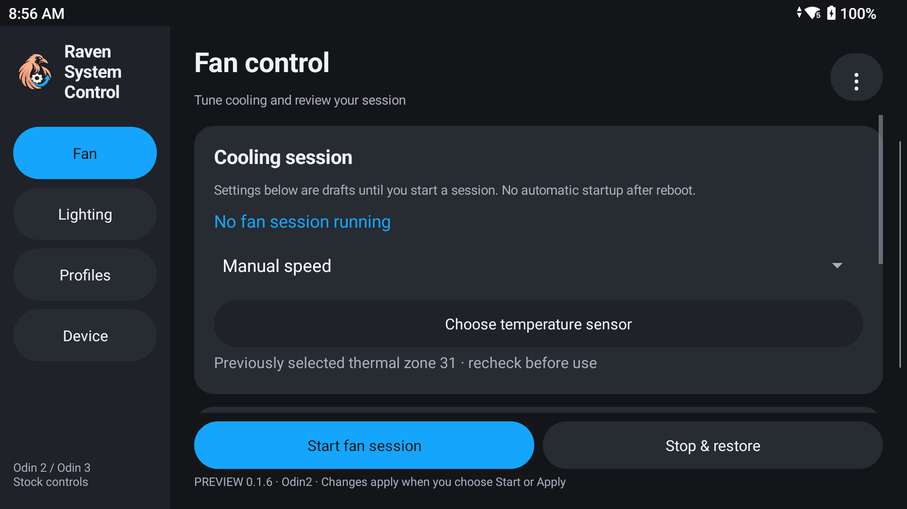

# Raven System Control

Standalone Android customization app for AYN Odin 2 and Odin 3, featuring configurable fan curves, stick lighting controls, and saved profiles while preserving the stock OS.

**Current release: 0.1.6-preview** · Package: `dev.odin.controls` · Version code: `7` · License: **GPL-3.0-only**

[Download the APK](https://github.com/Rsotbiemrptson/Raven-System-Control/releases/download/v0.1.6-preview/Raven-System-Control-0.1.6-preview.apk) · [Release notes and checksums](https://github.com/Rsotbiemrptson/Raven-System-Control/releases/tag/v0.1.6-preview)

## Features

- Temperature-based fan curves with separate on/off thresholds, two speed points, and a minimum 20-second run time.
- Manual fan control within the stock 50–70% PWM range. PWM is a requested duty, not a percentage of measured RPM.
- Temperature-sensor selection and a curve simulator that makes no device writes.
- Stick-ring colors and brightness through the OEM settings interface, with original-setting snapshots for restoration.
- Local profiles that load into a draft before you apply them.
- Raven-style side navigation, a three-dot menu, blue accents, and visible Start/Stop or Apply/Restore actions.
- A user-started fan notification with Stop & restore. A separate helper lease requests stock automatic cooling if app heartbeats stop, the selected sensor fails, temperature reaches 80°C, or the primary user changes.

The app uses AYN's factory `PServerBinder` service. It does not install root, modify firmware or fingerprints, remove OEM apps, disable SELinux, or add a boot hook. Controls require the factory service and expected hardware interfaces to be accessible.

## Device support

| Device | Accepted software | Status |
| --- | --- | --- |
| Odin 2 (`Odin2`) | Android 13 / API 33, build `Odin2_Custom_V1.0.0.400` | Limited on-device testing passed: manual fan duty, notification Stop/restoration, force-stop lease fallback, shared ring lighting and restoration. |
| Odin 3 (`Odin3`) | Android 15 / API 35 with the expected stock interfaces | Implemented from OEM interface evidence; hardware testing is still pending. |
| Other devices or Odin 2 builds | — | Hardware controls are blocked; compatibility is not assumed. |

**This is an experimental preview.** Automatic curves under load, sensor accuracy, sleep/wake, reboot/uninstall recovery, and other firmware versions are not validated. Keep stock thermal protections enabled. The helper's fallback is a request to the OEM service, not a replacement for platform thermal protection.

### Lighting limits

- **Odin 2 firmware 400:** one stock RGB color shared by both stick rings. Shared color and brightness also affect any enabled handle lights; the app preserves their enable settings.
- **Odin 3:** separate left/right ring RGB values are implemented through stock settings, but actual device behavior is untested.
- Four emitters per stick, independent per-emitter colors, and RGB charging-LED control remain investigation items. This release does not expose those controls or send undocumented channel commands.

## Getting started

1. Download the APK from the release linked above and install it on the intended supported device.
2. Open **Device** and run **Hardware checks**. Opening the app alone does not establish hardware compatibility.
3. Choose a temperature sensor only after checking its type and readings. Validate the sensor independently before relying on a temperature curve.
4. Begin with a short supervised manual-fan test, then use **Stop & restore** and confirm the original settings return. Enable notifications so the session and Stop action remain visible.
5. Test lighting **Apply** and **Restore ring settings** separately. Loading a saved profile only changes the draft.

There is no restart-after-reboot feature. A fan session may hand back to stock cooling after a long sleep if its heartbeat expires.

## Stop, restore and removal

Before uninstalling, open **Device → Stop fan & restore ring settings** and confirm the result. Normal fan stop restores the settings saved at session start. The force-stop fallback restores the saved speed setting and requests stock automatic mode.

Session journals and lighting snapshots are stored root-owned under `/data/local/odin-controls`, outside APK storage. Failed restoration retains the journal for a later retry. A small helper, last-result file and log may remain after a session ends. No automatic app cleanup can run after uninstall, and lighting restoration is not automatic after force-stop or uninstall.

## Build and test

See [BUILDING.md](BUILDING.md) for the Windows build, toolchain layout and host-only tests. All app Java, resources, helper code and tests are in [Source](Source).

The published preview APK uses the maintainer's existing preview signing identity. Private signing material is not included. Local builds use a separate development key and cannot update the published APK unless they use the same signing identity.

## Verification performed

- Compilation, fan-policy tests, mocked shell integration tests, APK signature, alignment and SHA-256 checksum checks.
- Odin 2 firmware 400: 55% requested PWM produced driver duty `27500` with a `50000` period and an increased driver speed reading; notification Stop restored stock automatic mode and prior settings.
- After force-stop, the final helper returned to stock automatic mode, restored the prior speed setting and duty `8000` by the 20-second check.
- Both stick rings visibly showed blue at 50% brightness, confirmed by the owner. All 12 monitored settings matched their original values after restoration.
- Landscape pages, profiles, persistence, menu, keyboard behavior and simulator were checked on Odin 2. Portrait fallback is implemented but remains unverified because the device held landscape during the rotation check.
- The 0.1.6 icon-only update was installed and inspected; hardware settings were unchanged. Its hardware helper matches the directly tested 0.1.4 helper.

## License and attribution

Raven System Control source and project artwork are licensed under **GNU GPL version 3 only**; see [LICENSE](LICENSE). Copyright (C) 2026 Raven System Control contributors.

The icon and portions of the UI are adapted from [Raven Backup](https://github.com/Rsotbiemrptson/RavenBackup), also GPL-3.0-only. Raven Backup and Raven App Control remain separate applications. See [NOTICE](NOTICE).
